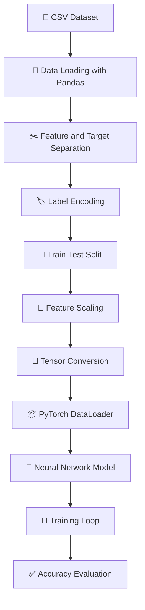

<div align="center">

# 🍷 Red Wine Quality Classification Using PyTorch

### A neural network that predicts red wine quality from its chemical properties


</div>

---

## 📑 Table of Contents

1. [Project Overview](#-project-overview)
2. [Objective](#-objective)
3. [Dataset](#-dataset)
4. [Project Workflow](#-project-workflow)
5. [Technologies Used](#️-technologies-used)
6. [Model Architecture](#️-model-architecture)
7. [Classification Classes](#-classification-classes)
8. [Project Structure](#-project-structure)
9. [How to Run](#-how-to-run-this-project)
10. [Output](#-output)
11. [Key Design Choices](#-key-design-choices)
12. [Concepts Covered](#-concepts-covered)
13. [Requirements](#-requirements)
14. [Learning Outcome](#-learning-outcome)
15. [Future Improvements](#-future-improvements)
16. [Author](#-author)
17. [Support](#-support)

---

## 📌 Project Overview

This project demonstrates a complete **CSV-based neural network classification pipeline** built with **PyTorch**.

The model takes the physicochemical properties of a red wine (acidity, sugar, chlorides, density, pH, sulphates, alcohol, etc.) as input and predicts the **wine quality class**.

---

## 🎯 Objective

To build a neural network that classifies red wine quality using a structured CSV dataset, while learning the full PyTorch workflow: from raw data to a trained and evaluated model.

---

## 📂 Dataset

| Property | Details |
|---|---|
| **File** | `winequality-red.csv` |
| **Samples** | 1,599 red wine records |
| **Input features** | 11 numerical physicochemical features |
| **Target column** | `quality` |

### 🔬 Input Features

| # | Feature | # | Feature |
|---|---|---|---|
| 1 | fixed acidity | 7 | total sulfur dioxide |
| 2 | volatile acidity | 8 | density |
| 3 | citric acid | 9 | pH |
| 4 | residual sugar | 10 | sulphates |
| 5 | chlorides | 11 | alcohol |
| 6 | free sulfur dioxide | | |

---

## 🧠 Project Workflow



**Step by step:**

1. **Data Loading** – read the CSV file using Pandas.
2. **Feature and Target Separation** – split the 11 input features from the `quality` column.
3. **Label Encoding** – convert quality values into class indices starting from `0`.
4. **Train-Test Split** – divide the data into training and testing sets.
5. **Feature Scaling** – standardize features using `StandardScaler`.
6. **Tensor Conversion** – convert NumPy arrays into PyTorch tensors.
7. **DataLoader** – batch the data for efficient training.
8. **Neural Network** – define the model using `torch.nn`.
9. **Training Loop** – forward pass, loss calculation, backpropagation, weight update.
10. **Evaluation** – calculate test accuracy and print the classification report.

---

## ⚙️ Technologies Used

| Technology | Purpose |
|---|---|
| 🐍 **Python** | Core programming language |
| 🐼 **Pandas** | Loading and handling CSV data |
| 🔢 **NumPy** | Numerical operations |
| 🧪 **Scikit-learn** | Label encoding, train-test split, scaling, metrics |
| 🔥 **PyTorch** | Building and training the neural network |

---

## 🏗️ Model Architecture

```text
Input Layer       →  11 features
Hidden Layer 1    →  64 neurons + ReLU
Hidden Layer 2    →  32 neurons + ReLU
Output Layer      →  6 classes
```

**Architecture flow:**

```text
11  →  64  →  32  →  6
```

---

## 📊 Classification Classes

The original wine quality scores in the dataset are:

```text
3, 4, 5, 6, 7, 8
```

They are encoded into:

```text
0, 1, 2, 3, 4, 5
```

| Original Quality | Encoded Class |
|:---:|:---:|
| 3 | 0 |
| 4 | 1 |
| 5 | 2 |
| 6 | 3 |
| 7 | 4 |
| 8 | 5 |

> 💡 This encoding is required because PyTorch's `CrossEntropyLoss` expects class labels starting from `0`.

---

## 📁 Project Structure

```text
Red-Wine-Calssification-Using-PyTorch/
│
├── 📄 winequality-red.csv     # Dataset
├── 🐍 train.py                # Data processing, model, training and evaluation
├── 📃 requirements.txt        # Python dependencies
├── 📘 README.md               # Project documentation
└── 🚫 .gitignore              # Files ignored by Git
```

---

## 🚀 How to Run This Project

### 1️⃣ Clone the Repository

```bash
git clone https://github.com/Kajal805-M/Red-Wine-Calssification-Using-PyTorch.git
```

### 2️⃣ Move into the Project Folder

```bash
cd Red-Wine-Calssification-Using-PyTorch
```

### 3️⃣ Create a Virtual Environment

```bash
python -m venv myenv
```

### 4️⃣ Activate the Virtual Environment

**Windows (PowerShell):**

```bash
myenv\Scripts\activate
```

**macOS / Linux:**

```bash
source myenv/bin/activate
```

### 5️⃣ Install Required Libraries

```bash
pip install -r requirements.txt
```

### 6️⃣ Run the Training File

```bash
python train.py
```

---

## 📈 Output

When you run the project, it displays:

- ✅ Dataset shape
- ✅ Missing values
- ✅ Input features
- ✅ Number of classes
- ✅ Model architecture
- ✅ Training loss
- ✅ Test accuracy
- ✅ Classification report

**Sample output** (illustrative; your exact numbers may differ):

```text
Epoch [10/100], Loss: 1.2456
Epoch [20/100], Loss: 1.1023
Epoch [30/100], Loss: 0.9821

Test Accuracy:
62.50%
```

---

## 🔑 Key Design Choices

### 📏 Why Feature Scaling?

The dataset has features with very different value ranges, for example `alcohol`, `density`, `sulphates` and `total sulfur dioxide`. `StandardScaler` brings them to a similar scale so that no single feature dominates training, and the network converges faster.

### 🔥 Why PyTorch?

- Easy tensor operations
- Simple neural network creation
- Automatic gradient calculation
- Flexible training loop
- Strong support for deep learning experiments

### 🎯 Why CrossEntropyLoss?

This is a **multi-class classification** problem, so the project uses:

```python
nn.CrossEntropyLoss()
```

It is designed for tasks where the model must pick one class out of several.

---

## 🧪 Concepts Covered

- CSV data loading
- Data preprocessing
- Label encoding
- Train-test split
- Feature scaling
- Tensor conversion
- PyTorch Dataset and DataLoader
- Neural network creation
- Training loop
- Loss calculation
- Backpropagation
- Model evaluation
- Accuracy calculation

---

## 🧾 Requirements

```text
pandas
numpy
scikit-learn
torch
```

---

## 🎓 Learning Outcome

After going through this project, you will understand how to build a complete **PyTorch classification pipeline** on a real-world CSV dataset.

You will learn how data is processed, converted into tensors, passed through a neural network, trained using backpropagation, and evaluated using accuracy.

---

## 🔮 Future Improvements

- [ ] Add a confusion matrix
- [ ] Add training loss visualization
- [ ] Handle class imbalance
- [ ] Try deeper neural networks
- [ ] Add dropout layers
- [ ] Add model saving and loading
- [ ] Deploy using Streamlit

---

## 👩‍💻 Author

**Kajal Maurya**

🔗 GitHub: [Kajal805-M](https://github.com/Kajal805-M)

---

## ⭐ Support

If you found this project helpful, please give it a ⭐ on GitHub!

<div align="center">

Made with ❤️ and 🍷 using PyTorch

</div>
